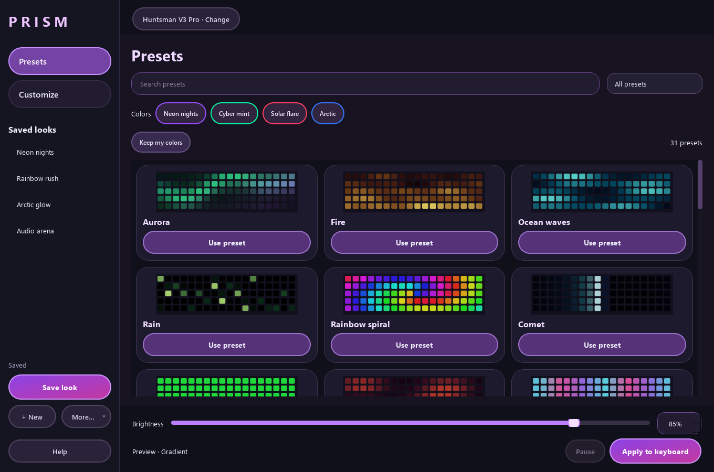

# Prism Keyboard Studio

A Windows app for keyboard lighting: 31 patterns, per-key painting, live audio effects, saved looks, and brightness on every screen.

**[Download the Windows app](https://github.com/2coins303/prism-keyboard-studio/releases/latest)** · [Quick start](docs/quick-start.txt) · [Keyboard compatibility](docs/keyboard-compatibility.csv)



## Run the app

1. Download `Prism-Keyboard-Studio-2.5.0-Windows-x64.zip` from Releases.
2. Extract the entire ZIP, then open **Prism Keyboard Studio.exe**.
3. Choose a preset, click **Apply to keyboard**, then **Save look**.

Keep the adjacent `bridge`, `_internal`, `source`, and `licenses` folders. Close other lighting controllers for the same keyboard. If an older Prism window is open, close it before starting this version.

Prism opens to Presets. Customize provides colors, motion, key painting, and audio. Brightness stays at the bottom; speed ranges from 0–1000%, with the original slow range preserved and a 10× maximum. Keep Prism open for animations.

## Keyboard support

- Direct USB: full-size Razer Huntsman V3 Pro, USB `1532:02A6`, US ANSI layout. This is the hardware-tested model.
- Bundled OpenRGB 1.1 bridge: 152 exact USB variants across seven brands. The [catalog](docs/keyboard-compatibility.csv) distinguishes upstream support from physical testing.
- Some models provide zones or static colors only. A similar product name does not guarantee support.

This app controls lighting. It does not change macros, actuation, Rapid Trigger, firmware, or drivers. Audio is analyzed locally and is never recorded or uploaded. Profiles stay in `%LOCALAPPDATA%\PrismKeyboardStudio` and are not part of this repository.

## Develop on Windows

Requires Windows 10/11 x64 and Python 3.13 x64.

```powershell
python -m venv .venv
.\.venv\Scripts\python.exe -m pip install -r src/requirements.txt
.\.venv\Scripts\python.exe src/app.py
```

The direct Huntsman connection works without downloading the bridge. To connect other supported keyboards, fetch the pinned official helper:

```powershell
.\.venv\Scripts\python.exe scripts/fetch_bridge.py
```

The fetcher checks archive and individual file hashes, includes corresponding OpenRGB source, and excludes PawnIO `.bin` modules. It never launches the helper or connects to a keyboard.

## Build and test

```powershell
.\build.ps1
```

This creates `.venv`, installs the pinned dependencies, fetches the verified bridge, runs the tests, builds the app, and produces a portable ZIP plus SHA256 checksum in `release/`. No keyboard is required for the build or tests.

To run only the tests:

```powershell
.\.venv\Scripts\python.exe -m unittest discover -s src -v
```

All 50 tests passed for the initial upload. The packaged app also passed resize checks at 100% and 150% scaling and the speed/profile checks. [Verification reports](docs/verification/) are included. GitHub Actions runs the same test suite and a packaging check on Windows.

For isolated app checks, use `--check-resize REPORT.json` or `--check-speed REPORT.json`. Both use offscreen windows and temporary profiles, without keyboard access. Other legacy verification switches can access physical hardware; see [the source notes](src/README.txt) before using them.

## Project layout

| Folder | Contents |
| --- | --- |
| `src/` | App, patterns, device support, profile storage, and tests |
| `scripts/` | Verified dependency fetching and portable packaging |
| `docs/` | Screenshots, compatibility catalog, guides, and local verification |
| `licenses/` | Dependency licenses and notices |

Local builds, earlier releases, user profiles, logs, credentials, and work folders are excluded from Git. The portable release includes its matching source and third-party notices.

## License

Prism is licensed under [GPL-2.0-or-later](LICENSE). Bundled dependencies retain their own licenses; see [third-party notices](THIRD-PARTY-NOTICES.txt) and [licenses](licenses/). OpenRGB's corresponding source ships with the portable release. Prism is independent software, not affiliated with Razer or other keyboard manufacturers.
